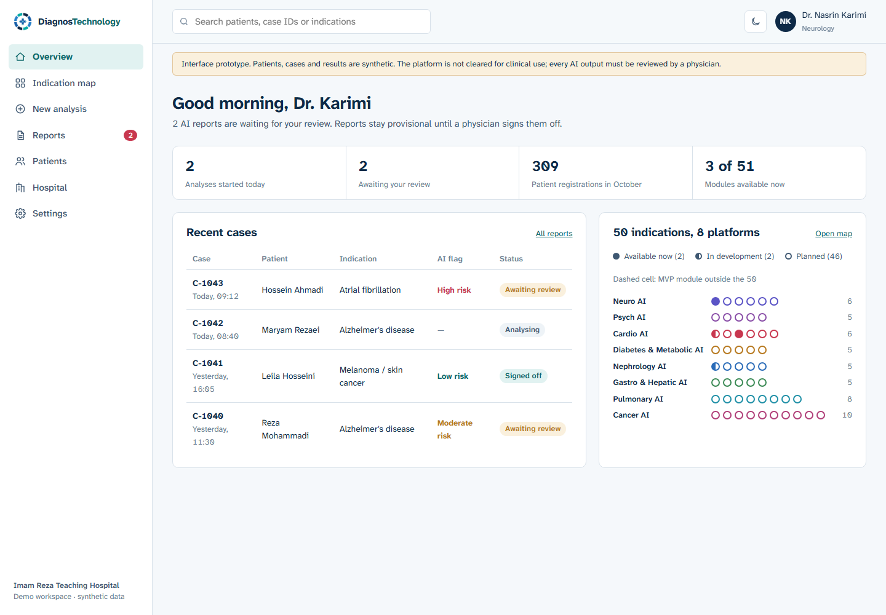
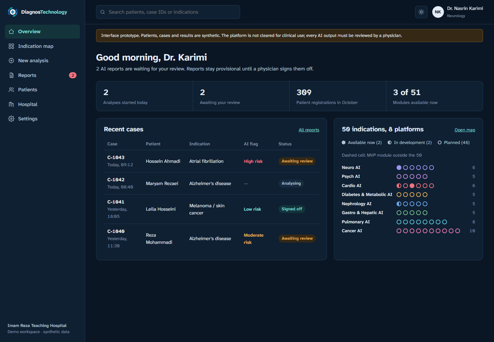
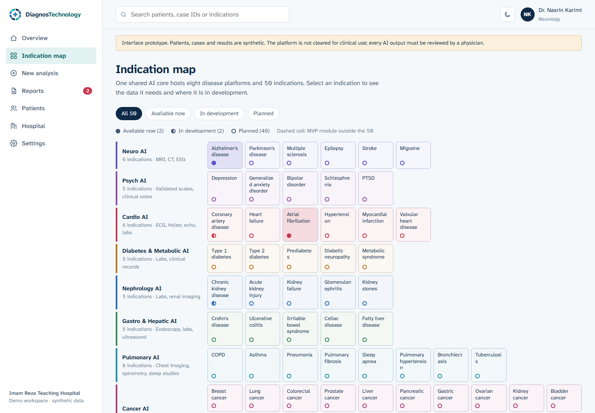
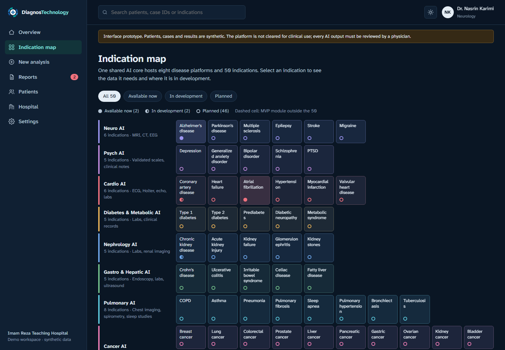
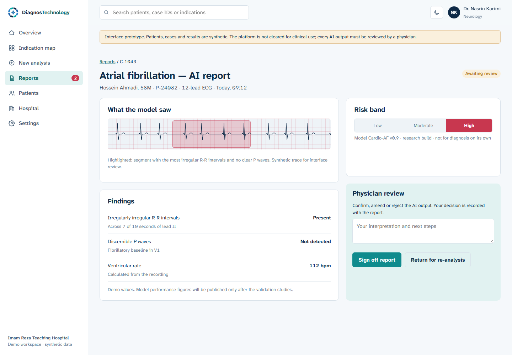
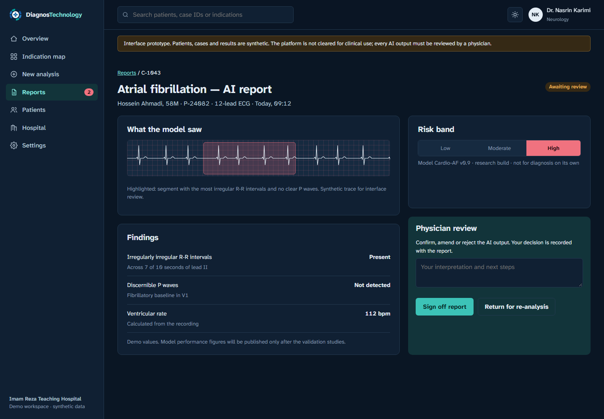
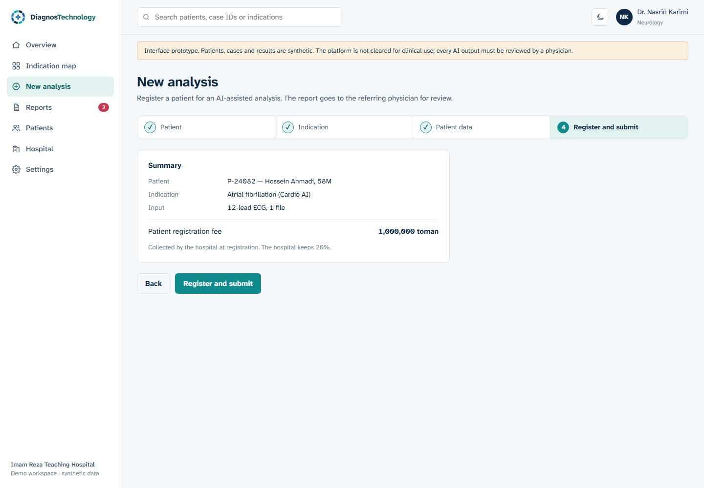
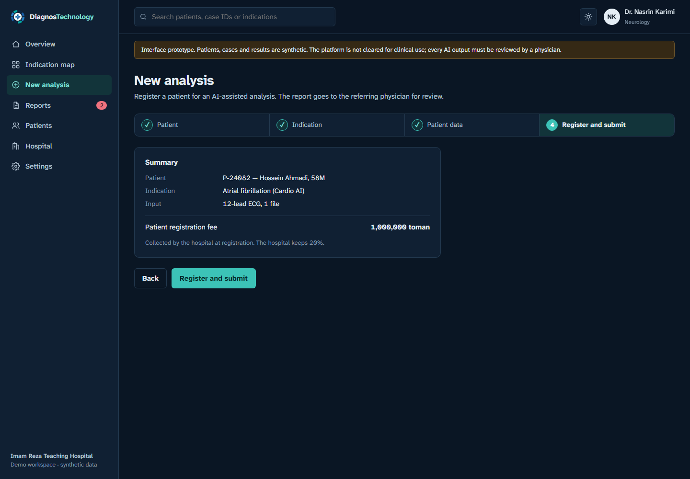
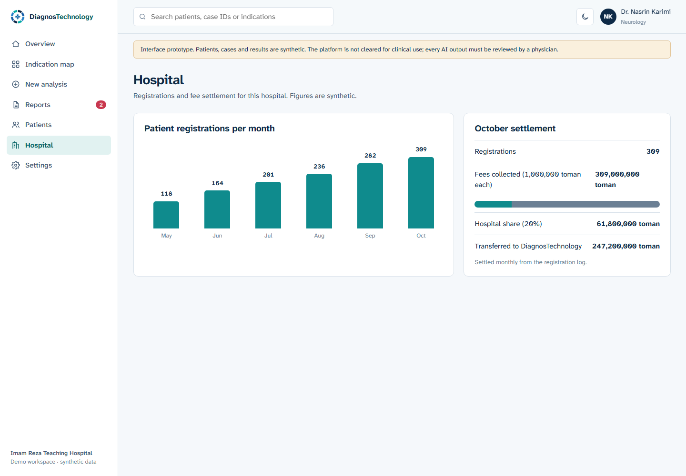
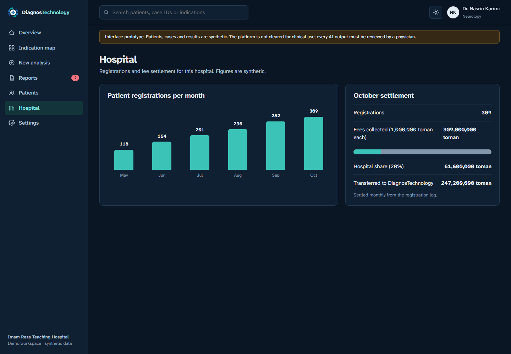

# DiagnosTechnology — Clinical Workspace (UI prototype)

Interface prototype for **DiagnosTechnology**, a modular AI clinical decision-support platform: one shared AI core, 8 disease platforms and 50 indications. It is aimed at hospital staff and physicians. The flow is: register a patient, choose an indication, submit the patient's data, review an explainable AI report and sign it off.

> **Prototype only.** All patients, cases and results are synthetic. The platform is not cleared for clinical use, and every AI output must be reviewed by a physician.

| Light | Dark |
|---|---|
|  |  |
|  |  |
|  |  |
|  |  |
|  |  |

## Screens

| Screen | What it does |
|---|---|
| Overview | Cases awaiting review, today's activity and a compact map of all 50 indications |
| Indication map | All 50 indications in 8 platform rows. Each cell shows its status; select one to see the patient data it needs and its development stage |
| New analysis | Four steps: patient, indication, patient data, then register and submit (patient registration fee collected by the hospital) |
| Reports / AI report | Evidence the model used (synthetic ECG with highlighted segment), findings, risk band and physician sign-off |
| Patients | Patients registered for AI-assisted analysis |
| Hospital | Monthly registrations and fee settlement (hospital keeps 20%) |
| Settings | Light, dark or match-system theme |

## The 50 indications

| Platform | Indications |
|---|---|
| Neuro AI (6) | Alzheimer's disease, Parkinson's disease, multiple sclerosis, epilepsy, stroke, migraine |
| Psych AI (5) | Depression, generalized anxiety disorder, bipolar disorder, schizophrenia, PTSD |
| Cardio AI (6) | Coronary artery disease, heart failure, atrial fibrillation, hypertension, myocardial infarction, valvular heart disease |
| Diabetes & Metabolic AI (5) | Type 1 diabetes, type 2 diabetes, prediabetes, diabetic neuropathy, metabolic syndrome |
| Nephrology AI (5) | Chronic kidney disease, acute kidney injury, kidney failure, glomerulonephritis, kidney stones |
| Gastro & Hepatic AI (5) | Crohn's disease, ulcerative colitis, irritable bowel syndrome, celiac disease, fatty liver disease |
| Pulmonary AI (8) | COPD, asthma, pneumonia, pulmonary fibrosis, sleep apnea, pulmonary hypertension, bronchiectasis, tuberculosis |
| Cancer AI (10) | Breast, lung, colorectal, prostate, liver, pancreatic, gastric, ovarian, kidney and bladder cancer |

**Status in the prototype:**
- **Available now:** Alzheimer's disease and atrial fibrillation (the current MVP modules). Melanoma / skin cancer is also an MVP module; it sits outside the 50 and is shown with a dashed border.
- **In development:** coronary artery disease and chronic kidney disease (phase one).
- **Planned:** all other indications.

Status is shown by shape (filled, half or outline) as well as colour.

## Design

- **Colour.** Light theme: clinical navy `#0E2A47`, surgical teal `#0F8B8D` for actions, alert red `#C8374F` reserved for high-risk flags, and cool white `#F5F8FB`. Dark theme: navy-black `#0A1624` with lifted teal `#3CC3B7`, for reading rooms and night shifts. Each of the 8 platforms has its own muted hue in both themes.
- **Type.** Atkinson Hyperlegible Next, a typeface designed for maximum legibility, with tabular numerals for clinical values.
- **Theme.** The theme follows the system setting by default. The toggle in the top bar or Settings saves your choice in the browser, and `?theme=dark` / `?theme=light` in the URL forces a theme for screenshots.
- **Accessibility.** Visible keyboard focus, labelled controls, the indication drawer closes with Esc, and reduced motion is respected. The layout works down to phone width.

## Run locally

No build step. Serve the folder with any static server, for example:

```bash
python -m http.server 4100
```

Then open http://localhost:4100.

## Files

- `index.html`: app shell
- `styles.css`: design tokens for both themes, plus components
- `app.js`: hash router and views
- `data.js`: synthetic demo content and the 50-indication catalogue
